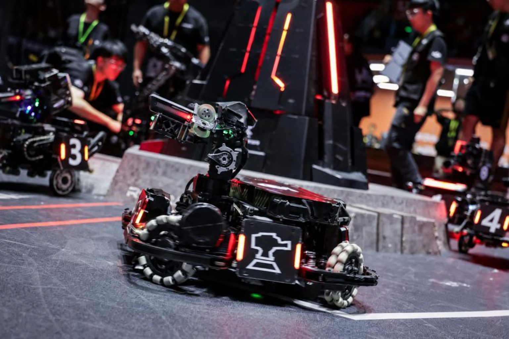

# 自瞄任务

以工业相机录制的赛场视频为输入，完成视频处理、ROS2 图像发布与订阅、机器人检测和结果保存流程。

## 开始前

1. 使用随仓库提供的输入视频 `materials/demo.mp4`，视频参数见 [材料说明](materials/README.md)。
2. 使用 **Ubuntu 22.04 + ROS2 Humble**，按[环境准备](../../ENV_SETUP.md)安装 Python、C++ 编译工具、CMake、OpenCV 和 ROS2；根据选择的语言和检测方法补充依赖，并记录实际版本。每次打开新终端，先执行 `source /opt/ros/humble/setup.bash`。
3. 选择 ROS2 节点的实现语言。仓库仅预留目录，学员自行创建对应的 ROS2 包和构建配置。

| 预留目录 | 用途 |
| --- | --- |
| `scripts/` | 视频信息脚本、灰度转换程序及构建配置 |
| `src/` | ROS2 包、节点和启动文件 |
| `materials/` | 本地输入视频及材料说明 |
| `out/` | 本地生成的结果视频 |

提交仓库保留 `task/Aiming/` 并沿用以上目录组织代码，包内模块名可自行确定。除随仓库提供的 `materials/demo.mp4` 外，其他输入材料、模型、录制数据和生成视频默认不进入普通 Git 提交。

## 代码规范

- 按上表组织代码，视频工具、图像处理和 ROS2 节点分工清楚，关键步骤有必要注释。
- ROS2 包提供完整的依赖、构建配置和 Launch 文件，确保能按运行说明构建和启动。
- 视频、模型和输出路径便于配置，读取或保存失败时给出提示，程序结束时正确关闭视频文件。使用开源代码或模型时注明来源并保留必要的许可证声明。

## 任务

### 1. 视频信息（Python）

请编写一个 Python 脚本，读取提供的赛场视频，并在运行时将视频的分辨率、帧率等基本信息打印到终端。

### 2. 灰度视频（C++）

请编写一个 C++ 程序，将输入视频的每一帧转换为灰度图像，并将结果保存为 MP4 视频。请提供一个简单的 CMake 构建文件，使该程序可以编译和运行，生成的可执行文件名称为 `video_to_grayscale`。

### 3. 视频发布（video_publisher）

请使用 Python 或 C++ 编写一个名为 `video_publisher` 的 ROS2 节点，实现以下功能：

- 读取提供的输入视频，逐帧获取图像。
- 将视频帧以 `sensor_msgs/msg/Image` 消息类型发布到 `/input_video` 话题。
- 发布频率与输入视频的原始帧率相同。

请提供该节点的 ROS2 包声明和与所选语言对应的构建或安装配置，使其可以编译或安装并运行。

### 4. 边缘检测（video_processor）

请使用 Python 或 C++ 编写一个名为 `video_processor` 的 ROS2 节点，实现以下功能：

- 订阅 `/input_video` 话题，接收 `sensor_msgs/msg/Image` 类型的视频帧。
- 对接收到的视频帧进行边缘检测，可以使用 Canny 算法或其他边缘检测算法。
- 将处理后的视频帧发布到 `/output_edge_video` 话题，消息类型为 `sensor_msgs/msg/Image`。

请提供该节点的 ROS2 包声明和与所选语言对应的构建或安装配置，使其可以编译或安装并运行。

### 5. 机器人检测（robot_detector）

请使用 Python 或 C++ 编写一个名为 `robot_detector` 的 ROS2 节点，实现以下功能：

- 订阅 `/input_video` 话题，接收 `sensor_msgs/msg/Image` 类型的视频帧。
- 检测视频帧中的机器人。可以使用预训练的深度学习模型，例如 YOLOv5 或其他开源模型，也可以采用其他检测方法。模型来源不限，可以自行查找已有模型，也可以使用公开数据集训练模型。
- 在检测到的机器人周围绘制边界框。
- 将绘制边界框后的视频帧发布到 `/output_detect_video` 话题，消息类型为 `sensor_msgs/msg/Image`。

请提供该节点的 ROS2 包声明和与所选语言对应的构建或安装配置，使其可以编译或安装并运行。

### 6. 结果保存（video_saver）

请使用 Python 或 C++ 编写一个名为 `video_saver` 的 ROS2 节点，实现以下功能：

- 订阅 `/output_edge_video` 和 `/output_detect_video` 话题，接收 `sensor_msgs/msg/Image` 类型的处理结果视频帧。
- 将 `/output_edge_video` 的视频帧保存为一个边缘检测结果 MP4 视频。
- 将 `/output_detect_video` 的视频帧保存为另一个机器人检测结果 MP4 视频。

请提供该节点的 ROS2 包声明和与所选语言对应的构建或安装配置，使其可以编译或安装并运行。

### 7. ROS2 统一启动

请编写一个 ROS2 启动文件，合理地统一启动 `video_publisher`、`video_processor`、`robot_detector` 和 `video_saver`，使视频发布、边缘检测、机器人检测和两路结果保存流程正常运行。请提供启动包所需的基础声明和安装配置，使该启动文件可以通过 ROS2 启动命令运行。

### 8. 运行及结果说明

在 `task/Aiming/README.md` 中补充运行与结果说明，使用实际验证过的信息，所有命令注明执行目录：

- 操作系统、ROS2、Python/C++、构建工具和依赖的实际版本，以及依赖安装步骤。
- 如何运行视频信息脚本，以及如何编译和运行灰度视频程序。
- 如何编译或安装 ROS2 包、加载环境、单独运行各节点，以及统一启动命令和所需参数。
- 输入视频的读取路径、实际分辨率和帧率；检测方法、模型获取方式及配置。
- 验证方法与实际结果：终端打印的视频信息、图像话题的类型和发布频率、边缘检测效果及机器人边界框。
- 灰度、边缘检测和机器人检测结果视频的下载链接、分辨率、帧率和编码，以及统一启动和视频播放的检查结果；如有已知问题或未完成项，也应写明。

## 提交要求

- 提交视频工具源码、CMake 配置、ROS2 包源码、包声明、启动文件，以及按上述要求补充完整的 `task/Aiming/README.md`。
- 用 `.gitignore` 排除构建产物、日志、虚拟环境、缓存及额外的视频和模型。Git 提交说明具体改动，提交前按说明检查流程能否复现、结果视频能否播放。
- 提交时提供姓名或昵称、仓库链接、分支、提交号和结果材料链接，验收以该版本为准。

## 完成后自查

- [ ] 视频信息脚本可运行，打印实际分辨率、帧率等信息。
- [ ] C++ 灰度程序能通过 CMake 构建，生成的 MP4 可以播放且画面为灰度。
- [ ] `/input_video` 按输入视频原始帧率发布，三路图像话题均使用 `sensor_msgs/msg/Image`。
- [ ] 边缘检测结果可观察，机器人检测结果包含边界框。
- [ ] 两路结果分别保存为可播放的 MP4；视频读完后文件能正常关闭。
- [ ] 统一启动文件能启动四个节点，运行说明足以让其他人复现流程。

处理结果和演示录像建议使用 **MP4 容器、H.264/AVC 编码、`yuv420p` 像素格式**，具体建议见 [视频与材料说明](materials/README.md)。演示录屏不能代替算法处理结果视频。
